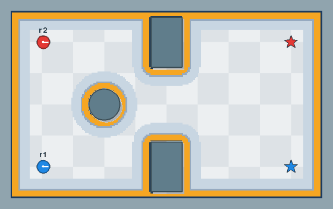
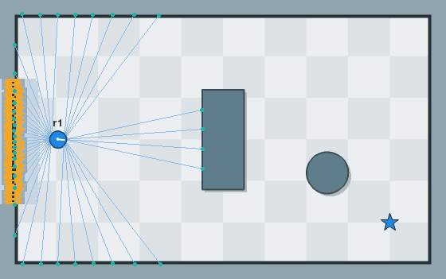

<p align="center">
  
</p>

<p align="center">
  <a href="https://github.com/dcapacho3/demuvo/actions/workflows/ci_pytest.yml"></a>
  
  
</p>

**A small, deterministic 2D world for robots.**

Demuvo is a top-down world you describe in a file: its size, its obstacles and its
robots. Robots move with known kinematic models, sense with simulated encoders and
lidar, and are driven by controllers, planners or filters that anyone can plug in. The
same world and the same seed always give the same run, so two algorithms can be
compared fairly.

## Status

Early development. Nothing is released yet and the API will change.

Working today:

- a world file (TOML) with a world size, obstacles (box, circle, polygon, wall) and
  robots, checked when it loads;
- one kinematic model, differential drive, driven by a ROS-style `Twist` command;
- solid obstacles: a robot that would enter an obstacle, the border or another robot is
  pushed back out and slides along it;
- wheel encoders with noise, and a dead-reckoning estimator that a robot can use in
  place of its true pose (`estimator = "dead_reckoning"`);
- a planner and a controller for each robot, chosen in the file as `module:Class`;
  built in: `StraightLine` and `AStar` (planners), `LineOfSight` (smoother) and
  `PurePursuit` (controller);
- a global costmap, built from the obstacles or read from a `map.yaml` (see
  "Costmap" below);
- lidars that a robot carries, any number of them, each with a mount, noise and its
  own scan rate, and a local costmap that the robot builds from their scans (see
  "Lidar and the local costmap" below);
- a step length and a controller rate that you set apart (see "Time" below);
- a top-down view, and GIF export from Python;
- a result, printed with `--result` when the window closes: for each task, whether the
  robot reached it and when, the distance it drove, and the number of collisions.

Not yet: the other kinematic models (car-like, forklift, mecanum, skid-steer), and a
runner that compares controllers on the same worlds and seeds.

## Try it

```bash
pip install -e ".[view]"
demuvo examples/worlds/demo.toml     # a robot drives to the star; --no-trail hides its path
demuvo examples/worlds/demo.toml --check   # check the file and open nothing
```

Add `--result` and demuvo prints how the run went when you close the window. After the
demo robot has driven to the star it reads:

```
r1 task 1: reached at 19.26 s
r1 drove 8.86 m
```

A task that is not done says how far the robot is from it. The distance is the exact
length of the path, and the time is simulated time, so the same seed gives the same lines.

A robot that has a task gets a path from its planner, and its controller follows it.
Several tasks for one robot, in file order, are waypoints:

```toml
[[robot]]
name = "r1"
model = "diff_drive"
shape = { name = "circle", radius = 0.2 }
pose = [1.0, 1.0, 0.0]                         # x, y, angle
controller = "demuvo.controllers:PurePursuit"
controller_params = { speed = 0.5, lookahead = 0.6, rotate_to_goal = true }

[[task]]
robot = "r1"
goal = [9.0, 5.0, 0.0]
goal_tolerance = [0.1, 0.1]                    # metres, radians
wait = 2.0                                     # optional: seconds to hold the goal
```

A task is done when the robot is within the tolerance and, if the task asks, standing
still (below 0.01 m/s and 0.01 rad/s) for `wait` seconds. `stop = true` or `false` sets
the standing-still test; the default is yes for a robot's last task and for a task with
a `wait`, and no for the waypoints in between.

`StraightLine` fills the segment from start to goal and ignores the costmap. `AStar`
searches the cells of the costmap and goes round obstacles; a cell of cost 253 or more
is blocked, and a costlier cell makes a step dearer, so the path keeps off walls. Its
settings go in `planner_params`:

- `connectivity`: 8 (the default) or 4, which gives paths with only 90-degree turns;
- `cost_weight`: 2.0 by default, how much cost raises the price of a step; 0 gives the
  shortest path;
- `tolerance`: 0 by default, in metres. A blocked goal then gives no path. A larger
  value lets the path end at the nearest free cell within that distance of the goal.

When there is no path, the robot stays still and the run says why in plain words, once
for the task, for example `AStar: the goal cell (90, 80) is blocked (cost 254), so the
robot's centre cannot be there` and `robot 'r1': no path for task 1, from (1.00, 1.00)
to (4.00, 4.50); it stays still`. The messages go through Python's `logging`, on the
`demuvo` logger.

A path of cell steps has corners. A smoother, named as `smoother = "module:Class"` in
the robot, with `smoother_params`, improves each path after the planner. `LineOfSight`
(`demuvo.smoothers.line_of_sight`) takes the farthest straight line that is clear of
blocked cells and no costlier than the stretch it replaces, and spaces the points
`spacing` metres apart (0.05 by default). `examples/worlds/astar.toml` has two robots
going round two boxes: 8-neighbour A* with a smoother, and 4-neighbour A* without.



To use your own, write a class and name it in the file. A planner has
`configure(costmap)`, which the navigation calls once with the robot's costmap, and
`plan(start, goal)`, which returns an array of shape (N, 3) of x, y, angle, or one of
shape (0, 3) if there is no path. A smoother has `configure(costmap)` and
`smooth(path)`. A controller has `command(obs)` and returns a `Twist`; it sees only the
observation (its pose, the path, the goal), not the simulation. From Python,
`Navigation` also takes a goal or a path from outside with `set_goal` and `set_path`.

## Costmap

A planner searches a costmap, a grid of costs: free 0, lethal 254 (an obstacle), 253
where the robot's centre cannot go, 255 unknown, and costs between that fall off with
distance from an obstacle. It has two layers: `static` (the obstacles and the border
as cells) and `inflation` (cost spread out by the robot's radius). Robots of one radius
share a costmap, and a robot's estimate carries it as `Estimate.map`. Every setting is
optional:

```toml
[costmap.global]
enabled = true                  # false: no costmap, planners get None
resolution = 0.05               # metres per cell
plugins = ["static", "inflation"]

[costmap.global.static]
source = "generate"             # or the path of a map.yaml, relative to this file

[costmap.global.inflation]
inflation_radius = 0.55         # metres
cost_scaling_factor = 10.0
```

A `map.yaml` and its `.pgm` image (the files a ROS map saver writes) replace the
generated map, so a planner can be developed with no SLAM first. The image must be a
PGM; the `mode` and `free_thresh` keys are ignored and unknown space counts as free.
A map read from a file keeps its own resolution and origin.

## Lidar and the local costmap

A robot carries a lidar when its `sensors` table names one. The lidar casts rays from
its mount into the scene and reads the distance to the first thing each ray meets: an
obstacle, the border, or another robot, but never the body of its own robot. A ray
that meets nothing within range reads `inf`. Angles are in radians, and a mount is
`[x, y, angle]` on the robot, in the same form as a pose.

```toml
sensors = { lidar = { beams = 360, max_range = 8.0, noise = 0.01 } }
```

| Setting | Default | Meaning |
|---|---|---|
| `beams` | 360 | number of rays |
| `fov` | 6.2832 | angle the beams cover; below a full circle they run edge to edge, centred on the sensor's heading |
| `max_range` | 8.0 | the farthest it reads, in metres |
| `min_range` | 0.0 | the nearest it reads; a reading below it is `inf` |
| `noise` | 0.0 | standard deviation of the error on each range, in metres |
| `period` | 0.1 | seconds between scans; the last scan is reported again between them |
| `mount` | `[0, 0, 0]` | where the lidar sits on the robot |

A robot can carry several. Give each its own name and a `type`:

```toml
sensors = { front = { type = "lidar", mount = [0.15, 0.0, 0.0], fov = 3.14159 }, rear = { type = "lidar", mount = [-0.15, 0.0, 3.14159], fov = 3.14159 } }
```

`[sensors.lidar]` sets the defaults of every lidar, and does not give a lidar to a
robot that names none. A controller gets `obs.scans`, the latest scan of each lidar by
name. A `Scan` has the `time`, the beam `angles`, the `ranges`, the `min_range` and
`max_range`, the `mount`, and `sensor_pose(pose)`, which gives where the sensor is in
the world for a robot at `pose`.

A robot with a lidar also builds a local costmap, a window round itself that it fills
from its scans. A controller gets it as `obs.costmap`. Each update clears the cells
along every beam up to its hit, or up to `raytrace_max_range` if it hit nothing, then
marks each hit within `obstacle_max_range`. The window follows the robot, a mark stays
in its cell until a beam clears it, and the hits are placed with the robot's estimated
pose, so an estimate that drifts shows in the costmap. Every setting is optional:

```toml
[costmap.local]
enabled = true                  # false: no local costmap
window = 3.0                    # metres, a square round the robot
resolution = 0.05               # metres per cell
period = 0.2                    # seconds between updates
plugins = ["obstacle", "inflation"]

[costmap.local.obstacle]
obstacle_max_range = 2.5        # farthest hit that is marked, in metres
raytrace_max_range = 3.0        # farthest a beam clears, in metres

[costmap.local.inflation]
inflation_radius = 0.55         # metres
cost_scaling_factor = 10.0
```

`examples/worlds/lidar.toml` has a robot with a front and a rear lidar that goes round a
box and a circle. The picture shows every third beam, a dot where each hit, and the
local costmap: light where cost is low, amber where the robot's centre cannot go.



On the author's computer the ray caster reads about 900,000 rays per second against
100 segments, and one update of the local costmap from a 360-beam scan takes about
4 ms.

## Time

The simulation moves in steps of `dt` seconds, set in `[world]` (default 0.01). Each
robot's controller runs on its own clock, `control_period` seconds apart (default 0.05,
the 20 Hz of the Nav2 controller), and its last command stays in force between runs:

```toml
[world]
size = [10.0, 6.0]
seed = 7
dt = 0.01                  # optional: seconds per step

[[robot]]
name = "r1"
model = "diff_drive"
shape = { name = "circle", radius = 0.2 }
pose = [1.0, 1.0, 0.0]
controller = "demuvo.controllers:PurePursuit"
control_period = 0.05      # optional: seconds between controller runs
```

`demuvo file.toml --dt 0.02` replaces the file's `dt`. A period shorter than `dt` is an
error, since a controller cannot run twice in one step. A period that is not a whole
number of steps works, with one warning: the gaps then alternate between two lengths,
one step apart, and their mean is the period. A new goal or path takes effect at the
controller's next run, up to one period later, as in Nav2. The controller's
`Observation.dt` is the time since it last ran.

The window draws each robot between its last two steps, so the motion stays smooth
whatever `dt` is. The picture lags the simulation by up to one step. With `dt = 0.05`
and a 60 Hz screen, a robot at 0.5 m/s would otherwise stand still in most frames and
then jump 25 mm; blended, it moves 8.3 mm in every frame. A GIF has one frame per
whole step and is not blended.

## Develop

```bash
git clone https://github.com/dcapacho3/demuvo.git
cd demuvo
pip install -e . --group dev     # needs pip 25.1 or later
pre-commit install
python -m pytest
```

Each part of the code is a folder under `src/demuvo/` (`world`, `models`, `costmap`, `sim`, `planners`,
`controllers`, `nav`, `evaluation`, `run`, `view`), and its tests sit in a `tests` folder inside it.

Pose maths comes from [robomath](https://github.com/dcapacho3/robomath).

## License

Apache 2.0. Copyright 2026 David Capacho. See [LICENSE](LICENSE).
