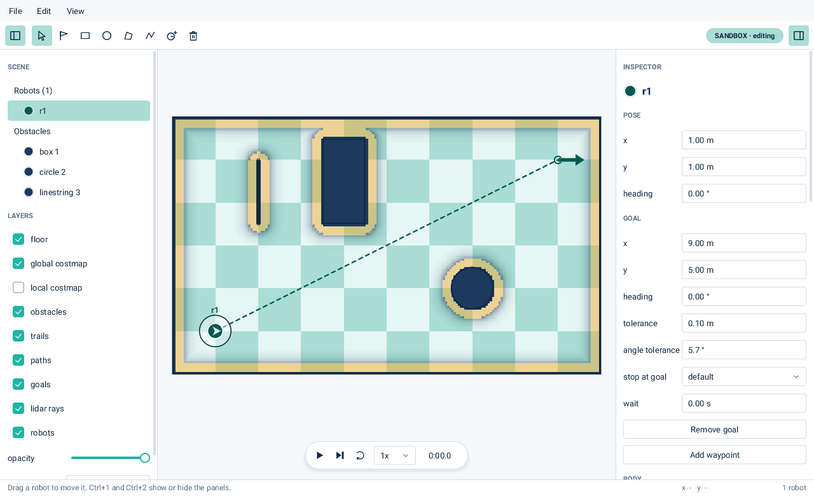

<p align="center">
  
</p>

<p align="center">
  <a href="https://github.com/dcapacho3/demuvo/actions/workflows/ci_pytest.yml"></a>
  
  
</p>

**A small, deterministic 2D world for robots.**

Demuvo is a top-down world you describe in a file: its size, its obstacles and its
robots. Robots move with known kinematic models, sense with simulated encoders and
lidar, and are driven by controllers, planners or filters that anyone can plug in. The
same world and the same seed always give the same run, so two algorithms can be
compared fairly.

## Status

Early development. Nothing is released yet and the API will change.

Working today:

- a world file (TOML) with a world size, obstacles (box, circle, polygon, wall) and
  robots, checked when it loads;
- one kinematic model, differential drive, driven by a ROS-style `Twist` command;
- solid obstacles: a robot that would enter an obstacle, the border or another robot is
  pushed back out and slides along it;
- wheel encoders with noise, and a dead-reckoning estimator that a robot can use in
  place of its true pose (`estimator = "dead_reckoning"`);
- a planner and a controller for each robot, chosen in the file as `module:Class`;
  built in: `StraightLine` and `AStar` (planners), `LineOfSight` (smoother) and
  `PurePursuit` (controller);
- a global costmap, built from the obstacles or read from a `map.yaml` (see
  "Costmap" below);
- lidars that a robot carries, any number of them, each with a mount, noise and its
  own scan rate, and a local costmap that the robot builds from their scans (see
  "Lidar and the local costmap" below);
- a step length and a controller rate that you set apart (see "Time" below);
- a native window, `demuvo`, to build a world with the pointer and the forms, save it
  to a file, open one, and run it (see "The window" below), and a recorder that
  writes GIFs with no window;
- a `Run` for scripts and benchmarks, and functions that build, edit and save a world
  (see "Use it from Python" below);
- a result, printed with `--result` when the window closes: for each task, whether the
  robot reached it and when, the distance it drove, and the number of collisions.

Not yet: the other kinematic models (car-like, forklift, mecanum, skid-steer), and a
runner that compares controllers on the same worlds and seeds. In the window, a
polygon or line can be moved and deleted but not reshaped, a robot body is a disc or a
box, and the lidar rays appear after the first step.

## Try it

```bash
pip install -e .
sudo apt install libglfw3 libgl1      # the window; Ubuntu and Debian
demuvo examples/worlds/demo.toml      # open a world; Space runs it; --bench fixes it
demuvo                                # a blank world to build in
demuvo examples/worlds/demo.toml --check   # check the file and open nothing
```

Add `--result` and demuvo prints how the run went when you close the window. After the
demo robot has driven to the star it reads:

```
r1 task 1: reached at 19.26 s
r1 drove 8.86 m
```

A task that is not done says how far the robot is from it. The distance is the exact
length of the path, and the time is simulated time, so the same seed gives the same lines.

To compare seeds, run the world with no window. `--seeds 4` runs the world's seed and
the three after it, each to the end or to `--limit` simulated seconds (120 by default);
`--jobs 4` runs four at once. The rows are the same for any number of jobs.

```bash
demuvo examples/worlds/demo.toml --seeds 4 --jobs 4
```

```
seed  done  time (s)  collisions
   7   yes     19.26           0
   8   yes     19.26           0
   9   yes     19.26           0
  10   yes     19.26           0
4 of 4 runs done
```

A robot that has a task gets a path from its planner, and its controller follows it.
Several tasks for one robot, in file order, are waypoints:

```toml
[[robot]]
name = "r1"
model = "diff_drive"
shape = { name = "circle", radius = 0.2 }
pose = [1.0, 1.0, 0.0]                         # x, y, angle
controller = "demuvo.controllers:PurePursuit"
controller_params = { speed = 0.5, lookahead = 0.6, rotate_to_goal = true }

[[task]]
robot = "r1"
goal = [9.0, 5.0, 0.0]
goal_tolerance = [0.1, 0.1]                    # metres, radians
wait = 2.0                                     # optional: seconds to hold the goal
```

A task is done when the robot is within the tolerance and, if the task asks, standing
still (below 0.01 m/s and 0.01 rad/s) for `wait` seconds. `stop = true` or `false` sets
the standing-still test; the default is yes for a robot's last task and for a task with
a `wait`, and no for the waypoints in between.

`StraightLine` fills the segment from start to goal and ignores the costmap. `AStar`
searches the cells of the costmap and goes round obstacles; a cell of cost 253 or more
is blocked, and a costlier cell makes a step dearer, so the path keeps off walls. Its
settings go in `planner_params`:

- `connectivity`: 8 (the default) or 4, which gives paths with only 90-degree turns;
- `cost_weight`: 2.0 by default, how much cost raises the price of a step; 0 gives the
  shortest path;
- `tolerance`: 0 by default, in metres. A blocked goal then gives no path. A larger
  value lets the path end at the nearest free cell within that distance of the goal.

When there is no path, the robot stays still and the run says why in plain words, once
for the task, for example `AStar: the goal cell (90, 80) is blocked (cost 254), so the
robot's centre cannot be there` and `robot 'r1': no path for task 1, from (1.00, 1.00)
to (4.00, 4.50); it stays still`. The messages go through Python's `logging`, on the
`demuvo` logger.

A path of cell steps has corners. A smoother, named as `smoother = "module:Class"` in
the robot, with `smoother_params`, improves each path after the planner. `LineOfSight`
(`demuvo.smoothers.line_of_sight`) takes the farthest straight line that is clear of
blocked cells and no costlier than the stretch it replaces, and spaces the points
`spacing` metres apart (0.05 by default). `examples/worlds/astar.toml` has two robots
going round two boxes: 8-neighbour A* with a smoother, and 4-neighbour A* without.


To use your own, write a class and name it in the file. A planner has
`configure(costmap)`, which the navigation calls once with the robot's costmap, and
`plan(start, goal)`, which returns an array of shape (N, 3) of x, y, angle, or one of
shape (0, 3) if there is no path. A smoother has `configure(costmap)` and
`smooth(path)`. A controller has `command(obs)` and returns a `Twist`; it sees only the
observation (its pose, the path, the goal), not the simulation. From Python,
`Navigation` also takes a goal or a path from outside with `set_goal` and `set_path`.

## The window



`demuvo` opens a native window. It is drawn by demuvo itself on numpy, shown through
the system's GLFW and OpenGL, and needs no Python package for the window: only
`libglfw3` and `libgl1`. The text is Roboto, from `fonts-roboto-unhinted` if that is
installed and else from a copy that ships with demuvo.

There are two modes:

- **sandbox** (`demuvo` or `demuvo world.toml`): the world is yours, and the window
  can set everything the world file holds. `demuvo` alone opens a blank world with one
  robot, `r1`, to build on. A change is allowed only while no run is in progress;
  Reset ends the run and unlocks editing. A change that cannot work is refused in the
  status bar, in words that name the robot and the setting.
- **benchmark** (`demuvo world.toml --bench`): the world is fixed, so every run is the
  same. Reset repeats it. Layers and panels still work.

The scene list and the layer switches are on the left, the world is in the middle with
a playback pill (play, step, reset, speed 0.25x to 8x, the clock), and the inspector is
on the right. The layers are global and local costmap, obstacles, trails, paths, goals, lidar rays
and robots (the floor is always shown), with an opacity and a palette for the costmaps; a world
with up to ten robots starts with the lidar rays on. Every robot has its own colour,
and is drawn with its real footprint and a white arrow for its heading.

**Building a world.** Pick a tool from the tool bar or by key, then use the pointer:

- *Select*: click a robot or an obstacle; drag it to move it.
- *Goal* (grey until a robot is selected): click the floor to set the selected robot's goal; Shift and click adds a
  waypoint after the goals it has.
- *Box* and *circle*: drag on the floor; the pointer then goes back to *select*. A box is drawn from one corner to the other, a
  circle from its centre outwards.
- *Polygon* and *line*: click the corners. Double click, right click, click near the first
  corner of a polygon, or press Enter to finish it; Esc cancels.
- *Add robot* and *delete*: the tool bar, Ctrl+N and Delete.

The inspector shows what is selected, and every field applies as you leave it. With
nothing selected it shows the world: its size, corner, seed and step, the sensors every
robot starts with, and the global and local costmap. With an obstacle selected it shows
the pose and size. With a robot selected it shows the pose, each goal with its
tolerance, stop rule and wait, the body (disc or box), the model, planner, smoother and
controller with their settings, where the controller gets its pose, and the sensors,
encoders and any number of lidars. A number field selects its number when you click, so
typing replaces it; Left, Right, Home, End, Delete and Ctrl+A work as in a text box.

**Files.** The File menu has New world, Open, Save and Save as. Open and Save as show a
file browser drawn by demuvo: click a folder twice to go in, click a file twice to take
it, use Up and Home, or type a name or a whole path in the Name box. Save as adds
`.toml` and asks before it replaces a file. The title bar shows the file and a star if
there are unsaved changes; New, Open and Quit say so the first time and go ahead the
second. Saving writes a new file: comments and the order of keys in the old file are not
kept. The icon is the demuvo logo tile.

**Log and panels.** Warnings and log lines of a run - a planner that finds no way, a
control period that is not whole steps - appear in a log panel along the bottom of the
window, not on the terminal. It opens by itself the first time a message comes; the tool
bar button, View > Log and Ctrl+3 show and hide it, and Clear empties it. Every panel can
be resized by dragging its edge, between the panel and the world.

**Undo.** Ctrl+Z takes back the last edit and Ctrl+Y makes it again; a drag is one step.
Opening or starting a world forgets the list.

**Lag.** While a run plays, the status bar shows "real time 100%": the simulated seconds
gained for each real second, as a share of the speed you chose. It turns amber below 90%.
Before the first step a robot with a goal already shows the path its planner, and its
smoother, will make; the path follows a robot you drag.

| Key | Does |
| --- | --- |
| Space | play or pause |
| S | step by one control period |
| R | reset |
| V, G, B, C, P, L | the select, goal, box, circle, polygon and line tools |
| Enter, Esc | end or cancel a polygon or line |
| Ctrl+N, Delete | add a robot, delete the selected robot or obstacle |
| Ctrl+O, Ctrl+S | open a world file, save the world |
| Ctrl+Z, Ctrl+Y | undo, redo |
| Ctrl+1, Ctrl+2, Ctrl+3 | show or hide the scene list, the inspector, the log |
| Tab, Shift+Tab | move the keyboard focus |
| Ctrl+Q | quit |

A GIF or a folder of PNG frames of any world is made with no window:

```bash
python -m demuvo.gui.record examples/worlds/lidar.toml run.gif --seconds 12 --fps 8 \
    --layers rays,local          # a path ending in / writes one PNG for each frame
```

A GIF stores only the part of each frame that changed, so a still scene with a few
moving robots makes a small file.

## Costmap

A planner searches a costmap, a grid of costs: free 0, lethal 254 (an obstacle), 253
where the robot's centre cannot go, 255 unknown, and costs between that fall off with
distance from an obstacle. It has two layers: `static` (the obstacles and the border
as cells) and `inflation` (cost spread out by the robot's radius). Robots of one radius
share a costmap, and a robot's estimate carries it as `Estimate.map`. Every setting is
optional:

```toml
[costmap.global]
enabled = true                  # false: no costmap, planners get None
resolution = 0.05               # metres per cell
plugins = ["static", "inflation"]

[costmap.global.static]
source = "generate"             # or the path of a map.yaml, relative to this file
# unknown = "free"              # a map file only: "free" or "blocked" for unknown cells

[costmap.global.inflation]
inflation_radius = 0.55         # metres
cost_scaling_factor = 10.0
```

A `map.yaml` and its `.pgm` image (the files a ROS map saver writes) replace the
generated map, so a planner can be developed with no SLAM first. The image must be a
PGM, and the `mode` key is ignored. A cell is an obstacle from `occupied_thresh`
(default 0.65) and free below `free_thresh` (default 0.25); between the two it is
unknown. `unknown` in `[costmap.global.static]` says what unknown cells count as:
`"free"` (default) or `"blocked"`, which a planner will not cross.
A map read from a file keeps its own resolution and origin. A world file with a map may
leave out `size` and `origin` in `[world]`: both then come from the map. With a `size`
given, the origin is `[0.0, 0.0]` unless the file sets it, and a size or origin that
differs from the map's gives a warning.

## Lidar and the local costmap

A robot carries a lidar when its `sensors` table names one. The lidar casts rays from
its mount into the scene and reads the distance to the first thing each ray meets: an
obstacle, the border, or another robot, but never the body of its own robot. A ray
that meets nothing within range reads `inf`. Angles are in radians, and a mount is
`[x, y, angle]` on the robot, in the same form as a pose.

```toml
sensors = { lidar = { beams = 360, max_range = 8.0, noise = 0.01 } }
```

| Setting | Default | Meaning |
|---|---|---|
| `beams` | 360 | number of rays |
| `fov` | 6.2832 | angle the beams cover; below a full circle they run edge to edge, centred on the sensor's heading |
| `max_range` | 8.0 | the farthest it reads, in metres |
| `min_range` | 0.0 | the nearest it reads; a reading below it is `inf` |
| `noise` | 0.0 | standard deviation of the error on each range, in metres |
| `period` | 0.1 | seconds between scans; the last scan is reported again between them |
| `mount` | `[0, 0, 0]` | where the lidar sits on the robot |

A robot can carry several. Give each its own name and a `type`:

```toml
sensors = { front = { type = "lidar", mount = [0.15, 0.0, 0.0], fov = 3.14159 }, rear = { type = "lidar", mount = [-0.15, 0.0, 3.14159], fov = 3.14159 } }
```

`[sensors.lidar]` sets the defaults of every lidar, and does not give a lidar to a
robot that names none. A controller gets `obs.scans`, the latest scan of each lidar by
name. A `Scan` has the `time`, the beam `angles`, the `ranges`, the `min_range` and
`max_range`, the `mount`, and `sensor_pose(pose)`, which gives where the sensor is in
the world for a robot at `pose`.

A robot with a lidar also builds a local costmap, a window round itself that it fills
from its scans. A controller gets it as `obs.costmap`. Each update clears the cells
along every beam up to its hit, or up to `raytrace_max_range` if it hit nothing, then
marks each hit within `obstacle_max_range`. The window follows the robot, a mark stays
in its cell until a beam clears it, and the hits are placed with the robot's estimated
pose, so an estimate that drifts shows in the costmap. Every setting is optional:

```toml
[costmap.local]
enabled = true                  # false: no local costmap
window = 3.0                    # metres, a square round the robot
resolution = 0.05               # metres per cell
period = 0.2                    # seconds between updates
plugins = ["obstacle", "inflation"]

[costmap.local.obstacle]
obstacle_max_range = 2.5        # farthest hit that is marked, in metres
raytrace_max_range = 3.0        # farthest a beam clears, in metres

[costmap.local.inflation]
inflation_radius = 0.55         # metres
cost_scaling_factor = 10.0
```

`examples/worlds/lidar.toml` has a robot with a front and a rear lidar that goes round a
box and a circle. The picture shows every third beam, a dot where each hit, and the
local costmap: light where cost is low, amber where the robot's centre cannot go.


On the author's computer the ray caster reads about 900,000 rays per second against
100 segments, and one update of the local costmap from a 360-beam scan takes about
4 ms.

## World origin

A world spans from its lower-left corner, the origin, to the origin plus `size`. The
origin is `[0.0, 0.0]` unless `[world]` sets it, and it may be negative, so a world can
reach west and south of zero. The border, the costmap and the window all follow it. Every
obstacle, robot start and goal must lie inside the box it gives:

```toml
[world]
size = [10.0, 6.0]
origin = [-5.0, -3.0]      # optional: x and y of the lower-left corner
seed = 7
```

`examples/worlds/origin.toml` is the demo world with its corner at `[-5.0, -3.0]`:
`demuvo examples/worlds/origin.toml`.

## Time

The simulation moves in steps of `dt` seconds, set in `[world]` (default 0.01). Each
robot's controller runs on its own clock, `control_period` seconds apart (default 0.05,
the 20 Hz of the Nav2 controller), and its last command stays in force between runs:

```toml
[world]
size = [10.0, 6.0]
seed = 7
dt = 0.01                  # optional: seconds per step

[[robot]]
name = "r1"
model = "diff_drive"
shape = { name = "circle", radius = 0.2 }
pose = [1.0, 1.0, 0.0]
controller = "demuvo.controllers:PurePursuit"
control_period = 0.05      # optional: seconds between controller runs
```

`demuvo file.toml --dt 0.02` replaces the file's `dt`. A period shorter than `dt` is an
error, since a controller cannot run twice in one step. A period that is not a whole
number of steps works, with one warning: the gaps then alternate between two lengths,
one step apart, and their mean is the period. A new goal or path takes effect at the
controller's next run, up to one period later, as in Nav2. The controller's
`Observation.dt` is the time since it last ran.

The window shows the state after the latest step. While it plays, each frame advances
the run by the real time since the last frame, at the chosen speed, but by at most
0.1 s, so a slow frame never makes the robots leap. A GIF has one frame per whole step
count that fits the frame rate.

## Use it from Python

`Run` steps a world without a window, so a script or a benchmark needs nothing else.
The `edit` functions build or change a world, and `save_world` writes it to a file.
Each edit returns a new world, and a bad one is refused with a message that names the
robot and the setting.

```python
from demuvo import Run, edit
from demuvo.world import save_world

world = edit.new_world()  # 10 by 6 m, one robot, r1
world = edit.set_goal(world, "r1", (8.0, 1.0, 0.0))
world = edit.add_robot(world, "r2", edit.free_pose(world))
world = edit.set_goal(world, "r2", (1.0, 5.0, 0.0))
save_world(world, "mine.toml")  # a file `demuvo mine.toml` opens

run = Run(world)
run.until_done(60.0)  # step until every goal is reached
print("\n".join(run.result()))
```

```text
r1 task 1: reached at 9.16 s
r1 drove 3.58 m
r2 task 1: reached at 14.06 s
r2 drove 4.36 m
0 collisions
```

`run.step(n)` takes `n` steps, `run.advance(seconds, budget)` covers some simulated time
within a wall-clock budget, and `run.poses`, `run.scans(name)`, `run.local_costmap(name)`
and `run.path(name)` read the state. Comments in a saved file are not kept.

## Develop

```bash
git clone https://github.com/dcapacho3/demuvo.git
cd demuvo
pip install -e . --group dev     # needs pip 25.1 or later
pre-commit install
python -m pytest
```

The window tests need `libglfw3`, `libgl1` and `xvfb`, and are skipped where they are
missing.

Each part of the code is a folder under `src/demuvo/` (`world`, `models`, `costmap`, `sim`, `planners`,
`controllers`, `nav`, `evaluation`, `run`, `gui`), plus the files `options.py`, `edit.py`
and `runner.py`, and its tests sit in a `tests` folder inside it.

Pose maths comes from [robomath](https://github.com/dcapacho3/robomath).

## License

Apache 2.0. Copyright 2026 David Capacho. See [LICENSE](LICENSE).
