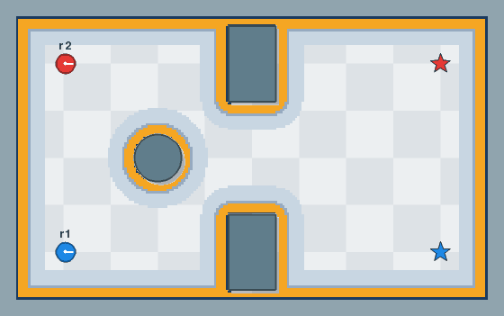
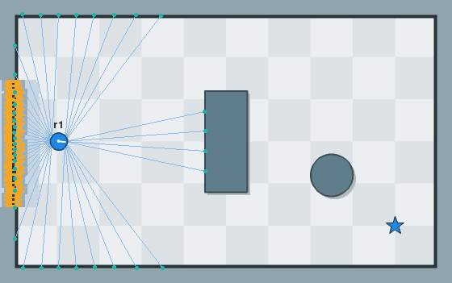

# The world file

A world is a TOML file. `demuvo file.toml` opens it, `demuvo file.toml --check` checks
it and opens nothing, and a window can save one for you ([the sandbox](sandbox.md)). A
file that is wrong is refused with a message that names the object and the key.

Here is the demo world, `examples/worlds/demo.toml`, with every common key. Almost all
of them are optional.

```toml
version = 1

[world]
size = [10.0, 6.0]        # metres
seed = 7                  # every random number of a run comes from this
dt = 0.01                 # optional: seconds per step

[[obstacle]]
name = "table"            # optional: what the window calls it
pose = [4.0, 4.5, 0.0]    # x, y, angle (radians)
shape = { name = "box", size = [1.0, 2.0] }   # length along x, width along y

[[obstacle]]
pose = [7.0, 2.0, 0.0]
shape = { name = "circle", radius = 0.5 }

[[obstacle]]              # a wall: points joined in order, no pose needed
shape = { name = "linestring", vertices = [[2.0, 5.0], [2.0, 3.5]] }

[[robot]]
name = "r1"
model = "diff_drive"
shape = { name = "circle", radius = 0.2 }     # or a box or a polygon
pose = [1.0, 1.0, 0.0]    # where it starts: x, y, angle
planner = "demuvo.planners:StraightLine"      # optional; this is the default
controller = "demuvo.controllers:PurePursuit" # optional; module:Class
controller_params = { speed = 0.5, lookahead = 0.6 }   # optional
control_period = 0.05     # optional: seconds between controller runs
# estimator = "dead_reckoning"   # the pose the controller sees; default "ground_truth"
# control_pose = "truth"         # the controller sees the true pose; the estimator still runs
# sensors = { encoders = { noise = 0.01, ticks_per_rev = 2048 } }

[[task]]                  # what a robot is to do; several for one robot are waypoints
robot = "r1"
goal = [9.0, 5.0, 0.0]
goal_tolerance = [0.1, 0.1]                   # optional: metres, radians
```

An obstacle is a `box`, a `circle`, a `polygon` (a closed shape whose edges do not
cross) or a `linestring` (a wall: points joined in order, with no area). Every obstacle,
robot start and goal must lie inside the world. A robot's body is a `circle`, a `box` or
a `polygon`. Obstacle names are for people: two obstacles cannot share one.

The robot model available now is `diff_drive`, a differential drive moved by a ROS-style
`Twist`; more models are on the roadmap. A robot that would enter an obstacle, the border or another robot is pushed back
out and slides along it, and the run counts a collision.

Wheel encoders have a `noise` and `ticks_per_rev`. The `dead_reckoning` estimator adds
the wheel increments to a pose, so its error grows as the robot drives. A robot uses it
with `estimator = "dead_reckoning"`.

## Tasks and planners

A robot that has a task gets a path from its planner, and its controller follows it.
Several tasks for one robot, in file order, are waypoints:

```toml
[[robot]]
name = "r1"
model = "diff_drive"
shape = { name = "circle", radius = 0.2 }
pose = [1.0, 1.0, 0.0]                         # x, y, angle
controller = "demuvo.controllers:PurePursuit"
controller_params = { speed = 0.5, lookahead = 0.6, rotate_to_goal = true }

[[task]]
robot = "r1"
goal = [9.0, 5.0, 0.0]
goal_tolerance = [0.1, 0.1]                    # metres, radians
wait = 2.0                                     # optional: seconds to hold the goal
```

A task is done when the robot is within the tolerance and, if the task asks, standing
still (below 0.01 m/s and 0.01 rad/s) for `wait` seconds. `stop = true` or `false` sets
the standing-still test; the default is yes for a robot's last task and for a task with
a `wait`, and no for the waypoints in between.

`StraightLine` fills the segment from start to goal and ignores the costmap. `AStar`
searches the cells of the costmap and goes round obstacles; a cell of cost 253 or more
is blocked, and a costlier cell makes a step dearer, so the path keeps off walls. Its
settings go in `planner_params`:

- `connectivity`: 8 (the default) or 4, which gives paths with only 90-degree turns;
- `cost_weight`: 2.0 by default, how much cost raises the price of a step; 0 gives the
  shortest path;
- `tolerance`: 0 by default, in metres. A blocked goal then gives no path. A larger
  value lets the path end at the nearest free cell within that distance of the goal.

When there is no path, the robot stays still and the run says why in plain words, once
for the task, for example `AStar: the goal cell (90, 80) is blocked (cost 254), so the
robot's centre cannot be there` and `robot 'r1': no path for task 1, from (1.00, 1.00)
to (4.00, 4.50); it stays still`. The messages go through Python's `logging`, on the
`demuvo` logger.

A path of cell steps has corners. A smoother, named as `smoother = "module:Class"` in
the robot, with `smoother_params`, improves each path after the planner. `LineOfSight`
(`demuvo.smoothers.line_of_sight`) takes the farthest straight line that is clear of
blocked cells and no costlier than the stretch it replaces, and spaces the points
`spacing` metres apart (0.05 by default). `examples/worlds/astar.toml` has two robots
going round two boxes: 8-neighbour A* with a smoother, and 4-neighbour A* without.



To use your own, write a class and name it in the file; see [your own
algorithms](plugins.md).

## Costmap

A planner searches a costmap, a grid of costs: free 0, lethal 254 (an obstacle), 253
where the robot's centre cannot go, 255 unknown, and costs between that fall off with
distance from an obstacle. It has two layers: `static` (the obstacles and the border
as cells) and `inflation` (cost spread out by the robot's radius). Robots of one radius
share a costmap, and a robot's estimate carries it as `Estimate.map`. Every setting is
optional:

```toml
[costmap.global]
enabled = true                  # false: no costmap, planners get None
resolution = 0.05               # metres per cell
plugins = ["static", "inflation"]

[costmap.global.static]
source = "generate"             # or the path of a map.yaml, relative to this file
# unknown = "free"              # a map file only: "free" or "blocked" for unknown cells

[costmap.global.inflation]
inflation_radius = 0.55         # metres
cost_scaling_factor = 10.0
```

A `map.yaml` and its `.pgm` image (the files a ROS map saver writes) replace the
generated map, so a planner can be developed with no SLAM first. The image must be a
PGM, and the `mode` key is ignored. A cell is an obstacle from `occupied_thresh`
(default 0.65) and free below `free_thresh` (default 0.25); between the two it is
unknown. `unknown` in `[costmap.global.static]` says what unknown cells count as:
`"free"` (default) or `"blocked"`, which a planner will not cross.
A map read from a file keeps its own resolution and origin. A world file with a map may
leave out `size` and `origin` in `[world]`: both then come from the map. With a `size`
given, the origin is `[0.0, 0.0]` unless the file sets it, and a size or origin that
differs from the map's gives a warning.

## Lidar and the local costmap

A robot carries a lidar when its `sensors` table names one. The lidar casts rays from
its mount into the scene and reads the distance to the first thing each ray meets: an
obstacle, the border, or another robot, but never the body of its own robot. A ray
that meets nothing within range reads `inf`. Angles are in radians, and a mount is
`[x, y, angle]` on the robot, in the same form as a pose.

```toml
sensors = { lidar = { beams = 360, max_range = 8.0, noise = 0.01 } }
```

| Setting | Default | Meaning |
|---|---|---|
| `beams` | 360 | number of rays |
| `fov` | 6.2832 | angle the beams cover; below a full circle they run edge to edge, centred on the sensor's heading |
| `max_range` | 8.0 | the farthest it reads, in metres |
| `min_range` | 0.0 | the nearest it reads; a reading below it is `inf` |
| `noise` | 0.0 | standard deviation of the error on each range, in metres |
| `period` | 0.1 | seconds between scans; the last scan is reported again between them |
| `mount` | `[0, 0, 0]` | where the lidar sits on the robot |

A robot can carry several. Give each its own name and a `type`:

```toml
sensors = { front = { type = "lidar", mount = [0.15, 0.0, 0.0], fov = 3.14159 }, rear = { type = "lidar", mount = [-0.15, 0.0, 3.14159], fov = 3.14159 } }
```

`[sensors.lidar]` sets the defaults of every lidar, and does not give a lidar to a
robot that names none. A controller gets `obs.scans`, the latest scan of each lidar by
name. A `Scan` has the `time`, the beam `angles`, the `ranges`, the `min_range` and
`max_range`, the `mount`, and `sensor_pose(pose)`, which gives where the sensor is in
the world for a robot at `pose`.

A robot with a lidar also builds a local costmap, a window round itself that it fills
from its scans. A controller gets it as `obs.costmap`. Each update clears the cells
along every beam up to its hit, or up to `raytrace_max_range` if it hit nothing, then
marks each hit within `obstacle_max_range`. The window follows the robot, a mark stays
in its cell until a beam clears it, and the hits are placed with the robot's estimated
pose, so an estimate that drifts shows in the costmap. Every setting is optional:

```toml
[costmap.local]
enabled = true                  # false: no local costmap
window = 3.0                    # metres, a square round the robot
resolution = 0.05               # metres per cell
period = 0.2                    # seconds between updates
plugins = ["obstacle", "inflation"]

[costmap.local.obstacle]
obstacle_max_range = 2.5        # farthest hit that is marked, in metres
raytrace_max_range = 3.0        # farthest a beam clears, in metres

[costmap.local.inflation]
inflation_radius = 0.55         # metres
cost_scaling_factor = 10.0
```

`examples/worlds/lidar.toml` has a robot with a front and a rear lidar that goes round a
box and a circle. The picture shows every third beam, a dot where each hit, and the
local costmap: light where cost is low, amber where the robot's centre cannot go.



On the author's computer the ray caster reads about 900,000 rays per second against
100 segments, and one update of the local costmap from a 360-beam scan takes about
4 ms.

## World origin

A world spans from its lower-left corner, the origin, to the origin plus `size`. The
origin is `[0.0, 0.0]` unless `[world]` sets it, and it may be negative, so a world can
reach west and south of zero. The border, the costmap and the window all follow it. Every
obstacle, robot start and goal must lie inside the box it gives:

```toml
[world]
size = [10.0, 6.0]
origin = [-5.0, -3.0]      # optional: x and y of the lower-left corner
seed = 7
```

`examples/worlds/origin.toml` is the demo world with its corner at `[-5.0, -3.0]`:
`demuvo examples/worlds/origin.toml`.

## Time

The simulation moves in steps of `dt` seconds, set in `[world]` (default 0.01). Each
robot's controller runs on its own clock, `control_period` seconds apart (default 0.05,
the 20 Hz of the Nav2 controller), and its last command stays in force between runs:

```toml
[world]
size = [10.0, 6.0]
seed = 7
dt = 0.01                  # optional: seconds per step

[[robot]]
name = "r1"
model = "diff_drive"
shape = { name = "circle", radius = 0.2 }
pose = [1.0, 1.0, 0.0]
controller = "demuvo.controllers:PurePursuit"
control_period = 0.05      # optional: seconds between controller runs
```

`demuvo file.toml --dt 0.02` replaces the file's `dt`. A period shorter than `dt` is an
error, since a controller cannot run twice in one step. A period that is not a whole
number of steps works, with one warning: the gaps then alternate between two lengths,
one step apart, and their mean is the period. A new goal or path takes effect at the
controller's next run, up to one period later, as in Nav2. The controller's
`Observation.dt` is the time since it last ran.

The window shows the state after the latest step. While it plays, each frame advances
the run by the real time since the last frame, at the chosen speed, but by at most
0.1 s, so a slow frame never makes the robots leap. A GIF has one frame per whole step
count that fits the frame rate.
