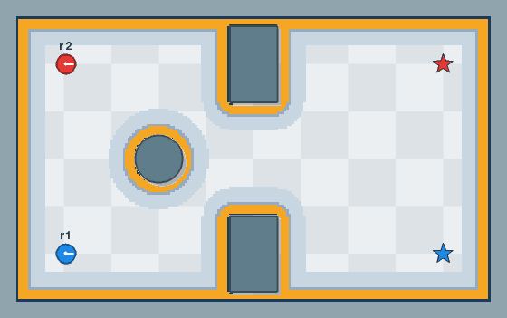
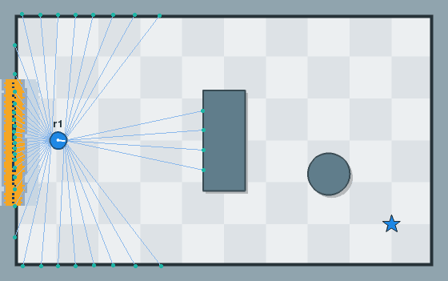

# The world file

A world is a TOML file. `demuvo file.toml` opens it, `demuvo file.toml --check` checks
it and opens nothing, and a window can save one for you ([the sandbox](sandbox.md)). A
file that is wrong is refused with a message that names the object and the key.

Here is the demo world, `examples/worlds/demo.toml`, with every common key. Almost all
of them are optional.

```toml
version = 1

[world]
size = [10.0, 6.0]        # metres
seed = 7                  # every random number of a run comes from this
dt = 0.01                 # optional: seconds per step

[[obstacle]]
name = "table"            # optional: what the window calls it
pose = [4.0, 4.5, 0.0]    # x, y, angle (radians)
shape = { name = "box", size = [1.0, 2.0] }   # length along x, width along y

[[obstacle]]
pose = [7.0, 2.0, 0.0]
shape = { name = "circle", radius = 0.5 }

[[obstacle]]              # a wall: points joined in order, no pose needed
shape = { name = "linestring", vertices = [[2.0, 5.0], [2.0, 3.5]] }

[[robot]]
name = "r1"
model = "diff_drive"      # or "ackermann", a car; see Robots
shape = { name = "circle", radius = 0.2 }     # or a box or a polygon
pose = [1.0, 1.0, 0.0]    # where it starts: x, y, angle
# params = { max_v = 0.8, max_w = 2.0 }       # optional: model values to replace
planner = "demuvo.planners:StraightLine"      # optional; this is the default
controller = "demuvo.controllers:PurePursuit" # optional; module:Class
controller_params = { speed = 0.5, lookahead = 0.6 }   # optional
control_period = 0.05     # optional: seconds between controller runs
# replan = true                  # plan again while driving; see Replanning
# estimator = "dead_reckoning"   # the pose the controller sees; default "ground_truth"
# control_pose = "truth"         # the controller sees the true pose; the estimator still runs
# sensors = { encoders = { noise = 0.01, ticks_per_rev = 2048 } }

[[task]]                  # what a robot is to do; several for one robot are waypoints
robot = "r1"
goal = [9.0, 5.0, 0.0]
goal_tolerance = [0.1, 0.1]                   # optional: metres, radians
```

An obstacle is a `box`, a `circle`, a `polygon` (a closed shape whose edges do not
cross) or a `linestring` (a wall: points joined in order, with no area). Every obstacle,
robot start and goal must lie inside the world. A robot's body is a `circle`, a `box` or
a `polygon`. Obstacle names are for people: two obstacles cannot share one.

A robot's `model` is the name of a kinematic model, moved by a ROS-style `Twist`.
There are two. `diff_drive` is a differential drive, two wheels on one axle, which can
turn in place. Its `params` are `max_v` and `max_w` (the speed and turn-rate limits,
1.0 m/s and 1.0 rad/s), and `wheel_radius` and `track` (0.05 m and 0.3 m), which the
encoders read. `ackermann` is a car: the front wheels steer and the rear wheels drive, so
it has a least turning radius and cannot turn in place. Its pose is the centre of the
rear axle. Its `params` are `max_v` (1.0 m/s), `max_steer` (the largest steering angle,
0.5 rad), `wheelbase` (rear axle to front axle, 0.3 m), and `wheel_radius` and `track`
(0.05 m and 0.25 m, the rear wheels) for the encoders. A turn rate the steering cannot
reach at the commanded speed is cut to the one it can, so a controller that spins in
place gets nowhere with this model. A robot that would enter an obstacle, the border or
another robot is pushed back out and slides along it, and the run counts a collision.

Wheel encoders have a `noise` and `ticks_per_rev`. The `dead_reckoning` estimator adds
the wheel increments to a pose, so its error grows as the robot drives. A robot uses it
with `estimator = "dead_reckoning"`. The third sensor, `perfect_pose`, reads the true
pose and has no settings; the default `ground_truth` estimator adds it itself, so a
world file never needs to name it.

## Actors

An actor is a movable obstacle that the global costmap is not built from. A planner
never sees one, so a robot meets an actor through its lidar, its local costmap and, if
it comes to that, a collision. This is the case [replanning](#replanning) was written
for: `blocked` and `changed` fire on what the lidar finds that the map did not show.

```toml
[actors]                  # optional: what every actor is like unless it says otherwise
solid = true              # a robot that runs into an actor is pushed back out
collide = false           # actors ignore each other

[[actor]]
name = "walker"           # required, and unique among the actors and the robots both
shape = { name = "circle", radius = 0.25 }    # a circle, a box or a polygon
pose = [3.0, 1.0, 0.0]    # where it starts
motion = "demuvo.actors:Waypoints"            # optional; module:Class, see below
motion_params = { points = [[3.0, 1.0], [3.0, 5.0]], speed = 0.6, loop = true }
# solid = false           # optional: a robot passes through, the collision is still counted
# collide = true          # optional: this actor meets other actors
```


`examples/worlds/actors.toml` is the world above.

An actor is not a robot. It has no model, no sensors, no estimator, no planner and no
tasks, and it gets no row in the [metrics file](../README.md#the-metrics-file). Like a
robot's body, its shape must enclose an area, and it must start inside the world. An
actor with no `motion` stands still, which makes it an obstacle the costmap cannot see.

The one motion available now is `demuvo.actors:Waypoints`: straight from the start pose
through `points`, in order, at `speed` metres per second, facing the way it goes. `mode`
says what happens after the last point: `"once"` stays there, `"loop"` (the default)
goes straight back to the start and round again, `"bounce"` turns round and comes back
through the points. `wait` is the seconds it stands at every point it arrives at, `delay`
the seconds before it first moves, and `face = false` keeps the start angle while it
moves. A point may carry more numbers: `[x, y, wait]` stands there for `wait` seconds
instead of the setting `wait`, and `[x, y, wait, heading]` also turns to `heading`
(radians) while it stands, then leaves facing the way it goes. One point and `"bounce"` is an actor going back and forth between two places. A
motion of your own is a class with `configure(start, rng)` and `pose_at(time)`; see
[your own algorithms](plugins.md).

`solid` and `collide` are two different questions. `solid` is about robots: `true`, the
default, pushes a robot back out of the actor as an obstacle would; `false` lets the
robot pass through, and the collision is still recorded. `collide` is about other
actors, and is `false` by default, so actors walk through each other. Two actors are
tested only if both say `true`, and a contact between them is recorded without either
being moved, which keeps a motion a function of time alone.

## Tasks and planners

A robot that has a task gets a path from its planner, and its controller follows it.
Several tasks for one robot, in file order, are waypoints:

```toml
[[robot]]
name = "r1"
model = "diff_drive"
shape = { name = "circle", radius = 0.2 }
pose = [1.0, 1.0, 0.0]                         # x, y, angle
controller = "demuvo.controllers:PurePursuit"
controller_params = { speed = 0.5, lookahead = 0.6, rotate_to_goal = true }

[[task]]
robot = "r1"
goal = [9.0, 5.0, 0.0]
goal_tolerance = [0.1, 0.1]                    # metres, radians
wait = 2.0                                     # optional: seconds to hold the goal
```

A task is done when the robot is within the tolerance and, if the task asks, standing
still (below 0.01 m/s and 0.01 rad/s) for `wait` seconds. `stop = true` or `false` sets
the standing-still test; the default is yes for a robot's last task and for a task with
a `wait`, and no for the waypoints in between.

`StraightLine` fills the segment from start to goal and ignores the costmap. `AStar`
searches the cells of the costmap and goes round obstacles; a cell of cost 253 or more
is blocked, and a costlier cell makes a step dearer, so the path keeps off walls. Its
settings go in `planner_params`:

- `connectivity`: 8 (the default) or 4, which gives paths with only 90-degree turns;
- `cost_weight`: 2.0 by default, how much cost raises the price of a step; 0 gives the
  shortest path;
- `tolerance`: 0 by default, in metres. A blocked goal then gives no path. A larger
  value lets the path end at the nearest free cell within that distance of the goal.

`Dubins` (`demuvo.planners:Dubins`) is the straight-line planner for a car: the
shortest path that bends no tighter than `turning_radius` (0.6 m; set it no lower than
the robot's least turning radius) and arrives at the goal's angle exactly, so an
`ackermann` robot can track it and finishes aligned. Like the straight line it ignores
the costmap. `ReedsShepp` (`demuvo.planners:ReedsShepp`) is Dubins for a car that may
back up: the shortest such path when the car can also drive in reverse, so a goal just
behind it is reached by backing up instead of by a loop. It has the same settings. The
path changes direction at its cusps, so the robot needs a controller that reverses:
`PurePursuit`, which follows the cusps. `DWB` does too. A robot that
cannot turn in place warns at the start of a run if its planner does not bound curvature,
as `StraightLine` and `AStar` do not.

When there is no path, the robot stays still and the run says why in plain words, once
for the task, for example `AStar: the goal cell (90, 80) is blocked (cost 254), so the
robot's centre cannot be there` and `robot 'r1': no path for task 1, from (1.00, 1.00)
to (4.00, 4.50); it stays still`. The messages go through Python's `logging`, on the
`demuvo` logger.

A path of cell steps has corners. A smoother, named as `smoother = "module:Class"` in
the robot, with `smoother_params`, improves each path after the planner. `LineOfSight`
(`demuvo.smoothers.line_of_sight`) takes the farthest straight line that is clear of
blocked cells and no costlier than the stretch it replaces, and spaces the points
`spacing` metres apart (0.05 by default). `examples/worlds/astar.toml` has two robots
going round two boxes: 8-neighbour A* with a smoother, and 4-neighbour A* without.



## Controllers

The controller turns the path into a command at each run. `PurePursuit` steers toward a
point of the path `lookahead` metres ahead and does not look at the lidar. On an
`ackermann` robot, which cannot turn in place, it keeps the turn rate inside the
steering, drives out of a large bearing error on full lock instead of turning on the
spot, and does not turn to the goal's angle; with `allow_reversing` it backs toward a
target behind it instead of going round forwards, a real car's way out of a tight
spot. `DWB`
(`demuvo.controllers:DWB`), the Dynamic Window Approach as Nav2's DWB controller does it,
is a local planner: it steers round what the robot's lidar sees, even what the planner's
map does not show.

```toml
controller = "demuvo.controllers:DWB"
controller_params = { max_vel_x = 0.5, max_vel_theta = 1.0, sim_time = 1.0 }
sensors = { lidar = { beams = 180, max_range = 4.0 } }
```

At each run it takes the speeds and turn rates the robot can reach from its last command
within `acc_lim_x` and `acc_lim_theta`, `vx_samples` by `vtheta_samples` of them, and
rolls each pair forward for `sim_time` seconds, a point every `time_granularity`. It
scores each trajectory on the robot's local costmap, the one built from its scans:

- a trajectory that comes within a cell of a cost of 253 or more is thrown out, and the
  others pay `obstacle_scale` times the mean cost they cross;
- `path_dist_scale` per metre from the trajectory's end to the path, and
  `goal_dist_scale` per metre of path left from there;
- `path_align_scale` and `goal_align_scale`: the same, for a point
  `forward_point_distance` ahead of the end, so the robot faces along the path. They
  are left out near the goal.

Distances to the path are counted through free cells, and cost more near obstacles by
`cost_weight`, as in `AStar`. While the path ahead runs through something the lidar
sees, the robot leaves it: it heads, through free cells, for the last free point of the
path in the local costmap, then follows the path again. At the goal it turns to the
goal's angle (`rotate_to_goal`, `rotate_speed`, `turn_gain`). `allow_reversing` lets
it back up. An `ackermann` robot cannot turn in place, so for one the window is shaped
like its steering, trajectories slower than `car_min_vel_x` are thrown out so it turns on
its least circle rather than inching, a path angle critic (`path_angle_scale`) makes it
swing toward the path, and it does not turn to the goal's angle. DWB tracks a path more
loosely than pure pursuit, so a car it drives meets a goal angle only within 0.3 rad or
so; give such a goal a tolerance to match, or the car `PurePursuit` with a short
`lookahead`, as `examples/worlds/ackermann.toml` does. `allow_reversing` lets a car
back up too: the path angle critic then counts facing away from its aim as good as
facing it, so backing toward the path costs nothing extra. A path that changes
direction, as a `ReedsShepp` path does at a cusp, is followed one run at a time: DWB
samples only speeds in the run's direction, aims at the run's end, and near the path
keeps the car facing as the path does, which lands it on the goal's angle
(`examples/worlds/reeds_shepp_dwb.toml`). A trajectory that leaves the local costmap is thrown out, so the window
should hold `max_vel_x * sim_time + forward_point_distance` each way: 0.825 m with the
defaults, inside the default 1.5 m. A robot with no lidar follows its path with no
obstacle check. If no trajectory that moves is free, the robot stops until one is, and
the log says so once. It has no recovery behaviours; [replanning](#replanning) gives it
a new path.

`examples/worlds/dwb.toml` gives a robot a straight-line path through a box and a
circle. Only its lidar shows them, and DWB takes it round both.

To use your own, write a class and name it in the file; see [your own
algorithms](plugins.md).

## Replanning

A robot plans once for each task: at its first step, when it starts the next waypoint,
and after a new goal. With `replan` it also plans again while it drives, as the Nav2
behaviour tree does. Its planner then searches the global costmap with the robot's
local costmap laid over it, cell by cell, so the path goes round what the lidar sees
even when the map does not show it; the planner and smoother are configured again
with the new costmap before each plan.

```toml
replan = true                                                      # the defaults
replan = { period = 1.0, blocked = true, off_path = 0.5, stuck = 2.0, timer = false, changed = 0.0 }
```

The window's [inspector](sandbox.md#the-inspector) switches it on and off and sets
`period` and `off_path`; the other settings are set here, and kept when the inspector
edits one of its two. From Python, `edit.set_replan` takes the same true, false or
table.

The triggers are checked at each run of the controller. The robot plans again when:

- `blocked`: the path ahead of it crosses a cell of its local costmap of cost 253 or
  more, where its centre cannot be. The lidar sees something on the path.
- `off_path`: it is farther than this many metres from its path, for instance after
  DWB steered it round an obstacle, so it gets a path from where it is. 0 turns it off.
- `stuck`: it has stood still, below 0.01 m/s and 0.01 rad/s, for this many seconds
  short of its goal. 0 turns it off.
- `changed`: its local costmap changed by this many square metres since the last plan:
  cells that became blocked or clear, counted where the window then and the window now
  both lie, so the window rolling on with the robot does not count, and more than two
  cells from anything blocked before or after, so a wall the lidar sees a little
  differently as the robot moves does not count either. Another robot or a moving
  obstacle came into view or went, and the plan may no longer be the best. A robot that
  had no local costmap when it planned measures from the first one it gets. 0 turns it
  off; a body the size of a robot changes about 0.3 square metres.
- `timer`: `period` seconds passed since the last plan, whatever else is true. This is
  the 1 Hz replanning of Nav2's default tree.

Two plans are never less than `period` seconds apart, and a robot within its goal's
distance tolerance never plans again: it is turning to the goal's angle or holding
there. A path given from outside with `set_path` is never planned again either; the
robot's next task, or a new goal, brings the planner back.

The new path is made at the controller's run, from the pose the controller sees, so it
starts at the robot, and it replaces the old one whole before the controller runs. The
controller follows it from that run on; the command it last gave stays in force until
then, and its `path_changes` grows by one, so a controller that keeps state about the
path starts over. A plan that finds no path leaves the path as it is, says so once, and
is tried again every `period`, quietly, until a path is found; a robot whose first plan
found nothing does the same. A planner that ignores the costmap, such as
`StraightLine`, gives the same line again, so `blocked` suits a planner that searches
it, such as `AStar`.

`examples/worlds/replan.toml` has a global costmap with no static layer, so the map
shows no obstacle. The robot finds the box and the circle with its lidar and plans
again round them; without `replan` it follows its first path into the box.

## Costmap

A planner searches a costmap, a grid of costs: free 0, lethal 254 (an obstacle), 253
where the robot's centre cannot go, 255 unknown, and costs between that fall off with
distance from an obstacle. It has two layers: `static` (the obstacles and the border
as cells) and `inflation` (cost spread out by the robot's radius). Robots of one radius
share a costmap, and a robot's estimate carries it as `Estimate.map`. Every setting is
optional:

```toml
[costmap.global]
enabled = true                  # false: no costmap, planners get None
resolution = 0.05               # metres per cell
plugins = ["static", "inflation"]

[costmap.global.static]
source = "generate"             # or the path of a map.yaml, relative to this file
# unknown = "free"              # a map file only: "free" or "blocked" for unknown cells

[costmap.global.inflation]
inflation_radius = 0.55         # metres
cost_scaling_factor = 10.0
```

A `map.yaml` and its `.pgm` image (the files a ROS map saver writes) replace the
generated map, so a planner can be developed with no SLAM first. The image must be a
PGM, and the `mode` key is ignored. A cell is an obstacle from `occupied_thresh`
(default 0.65) and free below `free_thresh` (default 0.25); between the two it is
unknown. `unknown` in `[costmap.global.static]` says what unknown cells count as:
`"free"` (default) or `"blocked"`, which a planner will not cross.
A map read from a file keeps its own resolution and origin. A world file with a map may
leave out `size` and `origin` in `[world]`: both then come from the map. With a `size`
given, the origin is `[0.0, 0.0]` unless the file sets it, and a size or origin that
differs from the map's gives a warning.

## Lidar and the local costmap

A robot carries a lidar when its `sensors` table names one. The lidar casts rays from
its mount into the scene and reads the distance to the first thing each ray meets: an
obstacle, the border, or another robot, but never the body of its own robot. A ray
that meets nothing within range reads `inf`. Angles are in radians, and a mount is
`[x, y, angle]` on the robot, in the same form as a pose.

```toml
sensors = { lidar = { beams = 360, max_range = 8.0, noise = 0.01 } }
```

| Setting | Default | Meaning |
|---|---|---|
| `beams` | 360 | number of rays |
| `fov` | 6.2832 | angle the beams cover; below a full circle they run edge to edge, centred on the sensor's heading |
| `max_range` | 8.0 | the farthest it reads, in metres |
| `min_range` | 0.0 | the nearest it reads; a reading below it is `inf` |
| `noise` | 0.0 | standard deviation of the error on each range, in metres |
| `period` | 0.1 | seconds between scans; the last scan is reported again between them |
| `mount` | `[0, 0, 0]` | where the lidar sits on the robot |

A robot can carry several. Give each its own name and a `type`:

```toml
sensors = { front = { type = "lidar", mount = [0.15, 0.0, 0.0], fov = 3.14159 }, rear = { type = "lidar", mount = [-0.15, 0.0, 3.14159], fov = 3.14159 } }
```

`[sensors.lidar]` sets the defaults of every lidar, and does not give a lidar to a
robot that names none. A controller gets `obs.scans`, the latest scan of each lidar by
name. A `Scan` has the `time`, the beam `angles`, the `ranges`, the `min_range` and
`max_range`, the `mount`, and `sensor_pose(pose)`, which gives where the sensor is in
the world for a robot at `pose`.

A robot with a lidar also builds a local costmap, a window round itself that it fills
from its scans. A controller gets it as `obs.costmap`; `DWB` steers by it. Each update clears the cells
along every beam up to its hit, or up to `raytrace_max_range` if it hit nothing, then
marks each hit within `obstacle_max_range`. The window follows the robot, a mark stays
in its cell until a beam clears it, and the hits are placed with the robot's estimated
pose, so an estimate that drifts shows in the costmap. Every setting is optional:

```toml
[costmap.local]
enabled = true                  # false: no local costmap
window = 3.0                    # metres, a square round the robot
resolution = 0.05               # metres per cell
period = 0.2                    # seconds between updates
plugins = ["obstacle", "inflation"]

[costmap.local.obstacle]
obstacle_max_range = 2.5        # farthest hit that is marked, in metres
raytrace_max_range = 3.0        # farthest a beam clears, in metres

[costmap.local.inflation]
inflation_radius = 0.55         # metres
cost_scaling_factor = 10.0
```

`examples/worlds/lidar.toml` has a robot with a front and a rear lidar that goes round a
box and a circle. The picture shows every third beam, a dot where each hit, and the
local costmap: light where cost is low, amber where the robot's centre cannot go.



On the author's computer the ray caster reads about 900,000 rays per second against
100 segments, and one update of the local costmap from a 360-beam scan takes about
4 ms.

## World origin

A world spans from its lower-left corner, the origin, to the origin plus `size`. The
origin is `[0.0, 0.0]` unless `[world]` sets it, and it may be negative, so a world can
reach west and south of zero. The border, the costmap and the window all follow it. Every
obstacle, robot start and goal must lie inside the box it gives:

```toml
[world]
size = [10.0, 6.0]
origin = [-5.0, -3.0]      # optional: x and y of the lower-left corner
seed = 7
```

`examples/worlds/origin.toml` is the demo world with its corner at `[-5.0, -3.0]`:
`demuvo examples/worlds/origin.toml`.

## Time

The simulation moves in steps of `dt` seconds, set in `[world]` (default 0.01). Each
robot's controller runs on its own clock, `control_period` seconds apart (default 0.05,
the 20 Hz of the Nav2 controller), and its last command stays in force between runs:

```toml
[world]
size = [10.0, 6.0]
seed = 7
dt = 0.01                  # optional: seconds per step

[[robot]]
name = "r1"
model = "diff_drive"
shape = { name = "circle", radius = 0.2 }
pose = [1.0, 1.0, 0.0]
controller = "demuvo.controllers:PurePursuit"
control_period = 0.05      # optional: seconds between controller runs
```

`demuvo file.toml --dt 0.02` replaces the file's `dt`. A period shorter than `dt` is an
error, since a controller cannot run twice in one step. A period that is not a whole
number of steps works, with one warning: the gaps then alternate between two lengths,
one step apart, and their mean is the period. A new goal or path takes effect at the
controller's next run, up to one period later, as in Nav2. The controller's
`Observation.dt` is the time since it last ran.

The window shows the state after the latest step. While it plays, each frame advances
the run by the real time since the last frame, at the chosen speed, but by at most
0.1 s, so a slow frame never makes the robots leap. A GIF has one frame per whole step
count that fits the frame rate.
